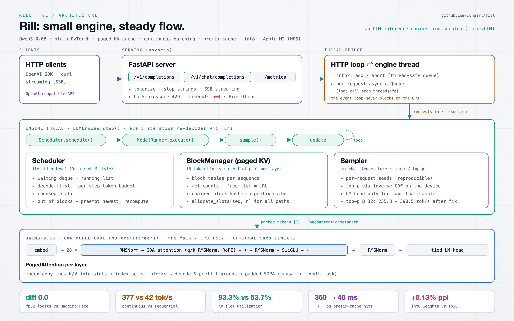
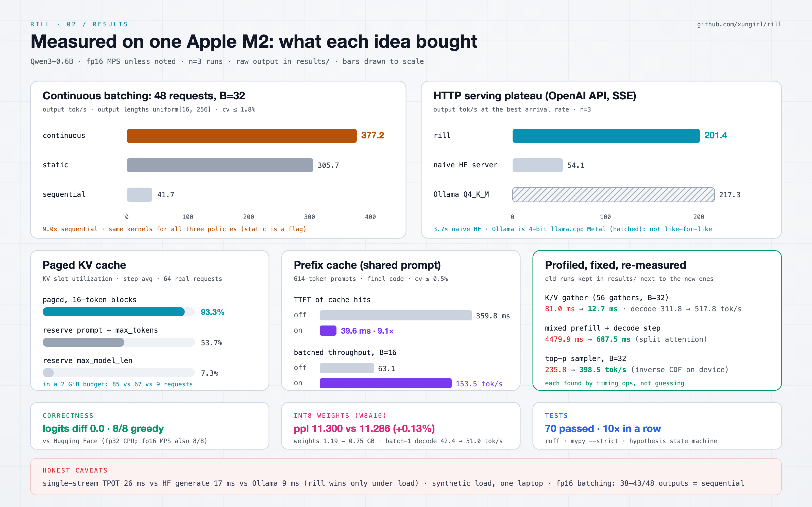

# Rill

**Small engine. Steady flow.**

> *A rill is a small stream: a light engine that keeps many requests flowing. Formerly named `ember`; raw logs in `results/` keep the old name.*

A from-scratch LLM inference engine and OpenAI-compatible serving stack for **Qwen3-0.6B**, in plain PyTorch:
own model code (no `transformers` in the engine), a **paged KV cache** with ref-counted blocks and **prefix
caching**, an iteration-level **continuous-batching scheduler** with chunked prefill and preemption, sampling with
per-request seeds, optional **int8 weights**, and a FastAPI server with SSE streaming, back-pressure and
Prometheus metrics. Built and measured on one Apple M2 laptop (MPS); every number below comes from a run on that
machine, with raw outputs in `results/` (see [BENCHMARK.md](BENCHMARK.md)).

```
            HTTP clients ──► FastAPI (asyncio)  /v1/completions  /v1/chat/completions  /metrics
                               │  tokenize · back-pressure (429) · timeouts (504) · SSE · stop strings
                               │  inbox: add/abort            ▲ per-request asyncio.Queue
                               ▼  (thread-safe queue)         │ (call_soon_threadsafe)
 ┌─────────────────────────── engine thread ──────────────────┴───────────────────────────────┐
 │ LLMEngine.step():  Scheduler.schedule() ─► ModelRunner.execute() ─► sample() ─► update       │
 │                                                                                             │
 │ Scheduler           waiting deque / running list · decode-first · token budget ·            │
 │                     chunked prefill · preempt newest + recompute · static policy (baseline) │
 │ BlockManager        block pool · free list = LRU (OrderedDict) · block tables · ref counts · │
 │                     chained block hashes → prefix cache                                     │
 └─────────────────────────────────────────┬───────────────────────────────────────────────────┘
                                           ▼  packed tokens [T] + PagedAttentionMetadata
 ┌──────────────────────────── Qwen3 (MPS fp16 / CPU fp32, optional int8 linears) ──────────────┐
 │ embed → 28 × [RMSNorm → GQA attn (q/k RMSNorm, RoPE) → + → RMSNorm → SwiGLU → +] → RMSNorm → │
 │ tied LM head (only rows that sample)                                                         │
 │ PagedAttention per layer: index_copy_ new K/V into slots → index_select blocks →             │
 │                           decode group & prefill group → padded SDPA with causal+length mask │
 └──────────────────────────────────────────────────────────────────────────────────────────────┘
```
More detail: [docs/ARCHITECTURE.md](docs/ARCHITECTURE.md) · capacity: [docs/CAPACITY.md](docs/CAPACITY.md) ·
interview notes (Chinese): [INTERVIEW.md](INTERVIEW.md) · log: [PROGRESS_LOG.md](PROGRESS_LOG.md)

## Diagrams





Hand-written SVG sources sit next to the PNGs; `docs/diagrams/render.sh` re-renders them with headless Chrome. Every number comes from `results/`.

## Project Journey

### 1. Model from scratch
- **Goal**: a Qwen3 forward pass that loads the official `safetensors` checkpoint with no `transformers` code.
- **Decision & alternatives**: write each block (RMSNorm, RoPE, GQA attention with Qwen3's per-head q/k norm,
  SwiGLU, tied embeddings) as a small `nn.Module`; tensors use a *packed token* layout `[T, ...]` so a batch can
  mix sequences without padding. Attention goes through an `AttentionBackend` protocol so the KV-cache layout can
  change later without touching the model. Alternative was wrapping HF modules — rejected: it hides exactly the
  parts an inference engine must control. q/k/v and gate/up matrices are fused at load time (fewer kernels).
- **Built**: `rill/model.py`, `rill/attention.py`, `rill/loader.py`, `rill/tokenizer.py`, `rill/simple_generate.py`.
- **Verified**: per-layer hidden states and logits identical to HF (max abs diff 0.0, fp32 and bf16 on CPU);
  greedy decoding token-identical to `transformers.generate` on 8 prompts × 64 tokens (fp32 CPU, fp16 MPS).
- **Measured**: single-request decode 45.9 tok/s on MPS fp16 vs 18.6 tok/s CPU fp32 (35.3 CPU bf16).
- **Problems / fixes**: bf16 on MPS diverged from the reference after 1–57 tokens on 5/8 prompts (even HF's own
  bf16 MPS run disagrees with ours on 2/8): bf16's 8-bit mantissa flips near-tie argmaxes. fp16 matched 8/8 → fp16
  is the MPS default.

### 2. Paged KV cache
- **Goal**: stop reserving `max_len` KV slots per request; hold only what has been written.
- **Decision & alternatives**: vLLM-style paging — a pool of fixed-size blocks (16 tokens), a free list, a block
  table per sequence and per-block ref counts. A single `allocate_slots(seq, n)` covers whole-prompt prefill,
  prefill chunks and decode. The pool is a flat `[num_blocks*block_size, kv_heads, head_dim]` tensor per layer, so
  writing is one `index_copy_` by slot id. Reading uses plain PyTorch gather into a padded batch + one batched SDPA
  call per layer; a fused paged-attention kernel (vLLM/FlashInfer) does not exist for MPS, and writing a Metal
  kernel was out of scope. Alternative considered: a per-sequence Python loop over SDPA (no padding) — rejected
  because kernel launches scale with batch size, which is exactly what hurts on MPS.
- **Built**: `rill/block_manager.py`, `rill/paged_attention.py`, `rill/model_runner.py`, `rill/sequence.py`.
- **Verified**: hypothesis state-machine test of block-manager invariants; paged attention over mixed
  prefill-chunk/decode batches equals the full causal forward (block sizes 1, 3, 4, 16); real-model batched paged
  greedy == contiguous greedy.
- **Measured** (64 real generations): KV slot utilization 93.3% (paged, bs=16) vs 53.7% (reserve prompt+max_tokens)
  vs 7.3% (reserve max_model_len) averaged over decode steps; in a 2 GiB budget that is 85 vs 67 vs 9 requests.
- **Problems / fixes**: the first memory benchmark OOM'd because I sized the pool with the naive formula
  (64 × 2048 slots = 14 GiB) — a nice demonstration of the problem itself; resized to Σ(prompt+max_tokens).

### 3. Continuous batching
- **Goal**: serve many requests at once without waiting for the slowest member of a batch.
- **Decision & alternatives**: iteration-level scheduling (Orca / vLLM): every step re-decides who runs. Running
  sequences are served first (decode = 1 token, unfinished prefill = next chunk), then waiting requests are
  admitted FCFS under a per-step token budget (chunked prefill). Out of KV blocks → preempt the newest running
  sequence and *recompute* it later rather than swap: on unified memory, swapping to "CPU memory" buys nothing.
  Alternatives: prefill-first scheduling (better TTFT, worse ITL stalls); static batching (kept as a policy flag
  so the baseline uses identical kernels).
- **Built**: `rill/scheduler.py`, `rill/engine.py`.
- **Verified**: on the tiny model, outputs equal single-sequence greedy for roomy, chunked (budget 7 tokens),
  memory-tight (preempting), sequential and static configs; on the real model in fp32 with preemption too.
- **Measured**: 48 requests with output lengths uniform[16,256]: continuous B=32 **377.3 tok/s** vs static B=32
  308.2 vs sequential 41.4 (9.1×); p99 e2e 18.9 s vs 23.1 s vs 171.1 s. Decode-only throughput 517.8 tok/s at
  B=32 and 670.4 at B=64.
- **Problems / fixes**: first calibration showed 102 ms per decode step at B=32. Timing each op found 81 ms in
  the K/V gather — MPS advanced indexing runs at ~7 GB/s. Block-level `index_select` is 6.4× faster
  (micro-benchmark) → +66% throughput at B=32. Also: fp16 batching is not bit-batch-invariant (38–43/48 outputs
  match the sequential run); fp32 is exact — documented rather than hidden.

### 4. Prefix caching
- **Goal**: requests sharing a prefix (system prompt, few-shot examples, chat history) should not recompute it.
- **Decision & alternatives**: vLLM-v1-style block hashing: each *full, already-computed* block is registered
  under `hash(prev_block_hash, block_tokens)`, so a hit implies the whole prefix matches. New requests attach the
  longest cached run of blocks (ref_count += 1) and prefill only the rest. Freed cached blocks stay in the free
  list (an `OrderedDict` used as an LRU queue) until the space is needed — caching never reduces capacity. Only
  full blocks are shared and they are never written again, so no copy-on-write is required. Alternative: a radix
  tree over tokens (SGLang) — finer-grained matching but more complex eviction; not needed for this workload.
- **Built**: prefix-cache half of `rill/block_manager.py`, admission in `rill/scheduler.py`, registration in
  `rill/engine.py`.
- **Verified**: unit + state-machine tests (ref counts, LRU order, collision safety, hash ↔ block bijection);
  engine outputs identical with cache on/off on the fp32 tiny model, including forced evictions.
- **Measured** (587-token shared system prompt, 32 requests): TTFT of cache hits **361.5 → 39.5 ms (9.2×)**;
  batched throughput 48.6 → 151.0 tok/s (3.1×) at the time; on the final code (after the Stage 6 attention fix
  made cache-off prefill faster) **63.1 → 153.5 tok/s (2.4×)**, hits 359.8 → 39.6 ms; 93% of prompt tokens served
  from cache.
- **Problems / fixes**: a test exposed that plain "least recently freed" eviction threw away cached blocks while
  empty blocks were free → empty blocks are now handed out first. In fp16, 29–31/32 greedy outputs match cache-off
  (different matmul shapes on a hit); exact in fp32.

### 5. Serving API
- **Goal**: an OpenAI-compatible HTTP server whose event loop never blocks on the GPU.
- **Decision & alternatives**: FastAPI/uvicorn for HTTP; the synchronous engine runs in **one dedicated thread**
  that is its only user (no locks). Handlers send `add`/`abort` commands through a thread-safe inbox and await a
  per-request `asyncio.Queue` filled via `loop.call_soon_threadsafe`. Detokenization and stop strings run on the
  event loop. Alternatives: `run_in_executor` per step (more hand-offs, same GIL), or a separate engine process
  over ZMQ like vLLM (better isolation from the GIL; more moving parts than this project needs).
- **Built**: `rill/server/{api,async_engine,metrics,protocol,__main__}.py`.
- **Verified**: 10 API tests against a real localhost uvicorn server (tiny model, generated tokenizer — no
  download): streaming == non-streaming, stop strings never leak partially, client disconnect aborts the
  sequence and frees its blocks, 429 back-pressure then recovery, 504 timeout, 400/422 validation.
- **Measured**: functional smoke test on the real model in `results/stage5_smoke.txt`; load results in Stage 6.
- **Problems / fixes**: a "failing" back-pressure test was the server correctly treating a garbage-collected
  `iter_lines()` iterator as a client disconnect — the test was fixed, not the server.

### 6. Load testing & baselines
- **Goal**: measure the server like a service: throughput and TTFT/TPOT/e2e percentiles vs arrival rate, find
  the saturation knee, compare against baselines on the same laptop.
- **Decision & alternatives**: own async load generator with **open-loop Poisson arrivals** (exposes queueing;
  closed-loop clients slow down with the server and hide overload) plus closed-loop points; synthetic seeded
  log-normal lengths (ShareGPT not downloaded — stated, not hidden); every point 3×, load-gated. Baselines: a
  naive `transformers.generate` server and Ollama (Homebrew; 522 MB Q4_K_M model) — no llama.cpp build needed.
- **Built**: `benchmarks/loadgen.py`, `benchmarks/bench_serving.py`, `benchmarks/hf_server.py`,
  `benchmarks/summarize_serving.py`.
- **Verified**: zero errors in all 66 measured points; repeat-to-repeat sd reported per point.
- **Measured**: rill knee between 2 and 3 req/s (TTFT p99 0.47 s → 15.5 s); plateau **201.4 tok/s** vs naive HF
  server **54.1 tok/s (3.7×)**; Ollama (4-bit, llama.cpp Metal) 217.3 tok/s — rill reaches ~93% of it with fp16
  eager PyTorch, but Ollama's single-user TPOT is 9 ms vs rill's 26 ms.
- **Problems / fixes**: the first sweep collapsed at 128 tok/s. Mixed prefill+decode steps padded all decode
  rows to the prefill chunk length inside SDPA; decode and prefill rows are now attended in separate groups
  (mixed-step forward 4479.9 → 687.5 ms). The pre-fix log is kept in `results/`.

### 7. Sampling & int8
- **Goal**: real sampling controls with reproducible seeds, and one optimization measured end to end.
- **Decision & alternatives**: temperature → top-k → top-p masks batched on the device; each request has its own
  `torch.Generator` (from `seed`), so its samples don't depend on batch neighbours and survive preemption. For
  the optimization I chose weight-only int8 (per-channel symmetric, `torch._weight_int8pack_mm`) over
  speculative decoding: there is no smaller Qwen3 draft model, and prompt-lookup speculation needs KV-slot
  rollback in the paged cache — int8 could be finished and evaluated properly.
- **Built**: `rill/sampling.py`, `rill/quant.py` (+ `--int8` server flag), `benchmarks/bench_quality.py`.
- **Verified**: mask vs brute-force reference (hypothesis), empirical sampling frequencies vs softmax, seeded
  determinism across batch composition and preemption, int8 rounding error bound.
- **Measured**: int8 perplexity **11.300 vs 11.286 fp16 (+0.13%)**, weights 1.19 → 0.75 GB, batch-1 decode
  **42.4 → 51.0 tok/s (+20%)**, no gain at batch 32 (532 vs 538).
- **Problems / fixes**: top-p at batch 32 was 56% slower than greedy because of a per-row CPU `multinomial` over
  the 152k vocabulary; inverse-CDF sampling on the device made sampled decoding 69% faster (235.8 → 398.5 tok/s).

### 8. Ops polish
- **Goal**: make it runnable and checkable by someone else.
- **Decision & alternatives**: CPU Dockerfile with a uv-synced venv, non-root user, healthcheck; the model is
  mounted (read-only HF cache), not baked in. Linux resolves torch from the PyTorch CPU index via
  `[tool.uv.sources]`, so neither Docker nor CI pulls CUDA wheels. CI = ruff + ruff format + strict mypy + pytest
  on CPU with the tiny random model; real-model tests skip themselves when the checkpoint is absent.
- **Built**: `Dockerfile`, `.github/workflows/ci.yml`, `docs/ARCHITECTURE.md`, `docs/CAPACITY.md`.
- **Verified**: image built and served a real chat completion under colima; every CI step run locally and green
  (64 passed / 6 skipped without the model, 70 passed with it); full suite run 10× in a row.
- **Measured**: reran Stage 3/4 benchmarks on the final code (continuous B=32 377.2 tok/s — unchanged; prefix
  cache batched gain now 2.4×).
- **Problems / fixes**: first Docker run could not find the model — the mount path assumed root but the image
  runs as a non-root user; set `HF_HUB_CACHE=/models/hub` explicitly.

### Key metrics

| metric | value | how measured | source |
|---|---|---|---|
| logits / per-layer max abs diff vs HF (fp32, 28 layers) | 0.0 | `benchmarks/parity_report.py` | `results/stage1_parity.json` |
| greedy token parity vs HF, fp16 MPS | 8/8 prompts × 64 tokens | same | `results/stage1_parity.json` |
| single-request decode, MPS fp16 | 45.9 ± 0.8 tok/s (n=3) | `benchmarks/bench_single.py` | `results/stage1_single_request.json` |
| single-request decode, CPU fp32 | 18.6 ± 0.0 tok/s (n=3) | same | `results/stage1_single_request.json` |
| KV slot utilization, paged bs=16 vs reserve prompt+max_tokens | 93.3% vs 53.7% (step avg, 64 real requests) | `benchmarks/bench_memory.py` | `results/stage2_memory.json` |
| requests fitting in 2 GiB KV: paged vs naive max_model_len=2048 | 85 vs 9 | same | `results/stage2_memory.json` |
| offline throughput, continuous vs static vs sequential (B=32, 48 req), final code | 377.2 vs 305.7 vs 41.7 tok/s (n=3, cv ≤ 1.8%) | `benchmarks/bench_batching.py` | `results/stage3_batching.json` |
| decode throughput at batch 32 / 64 | 517.8 / 670.4 tok/s | `benchmarks/bench_decode_batch.py` | `results/stage3_decode_batch.json` |
| K/V gather fix (56 gathers, B=32) | 81.0 → 12.7 ms | `benchmarks/micro_gather.py` | `results/micro_gather.json` |
| prefix cache: TTFT of hits, 614-token prompts, final code | 359.8 → 39.6 ms (9.1×, n=3, cv ≤ 0.5%) | `benchmarks/bench_prefix.py` | `results/stage4_prefix_cache.json` |
| prefix cache: batched throughput (B=16), final code | 63.1 → 153.5 tok/s (2.4×) | same | `results/stage4_prefix_cache.json` |
| HTTP serving plateau, rill vs naive HF server | 201.4 vs 54.1 tok/s (3.7×), n=3 | `benchmarks/bench_serving.py` | `results/stage6_serving_{rill,hf}.json` |
| rill saturation knee (open-loop, ~215-in/110-out tokens) | λ 2→3 req/s: TTFT p99 0.47 s → 15.5 s | same | `results/stage6_serving_ember.json` |
| rill vs Ollama Q4_K_M peak / single-user TPOT | 201.4 vs 217.3 tok/s / 26 vs 9 ms | same | `results/stage6_serving_ollama.json` |
| mixed prefill+decode step fix (1024 chunk + 31 decodes) | 4479.9 → 687.5 ms | `benchmarks/micro_mixed_step.py` | `results/micro_mixed_step.json` |
| int8 W8A16: perplexity / weights / batch-1 decode | +0.13% / −37% / +20% (51.0 vs 42.4 tok/s) | `benchmarks/bench_quality.py` | `results/stage7_quality_speed.json` |
| sampled (top-p) decode at B=32, before → after sampler fix | 235.8 → 398.5 tok/s | same | `results/stage7_quality_speed{_before_sampler_fix,}.json` |
| test suite | 70 tests, 10/10 consecutive full runs green | `uv run pytest -q` ×10 | `results/stage8_test_10x.txt` |

### Next steps
1. Cut per-step Python overhead (persistent metadata buffers, fewer host↔device syncs) — the main reason
   single-stream TPOT trails HF `generate` and Ollama.
2. A fused paged-attention kernel (Metal on MPS, or FlashInfer on CUDA) instead of gather + padded SDPA.
3. Separate API-server and engine processes (ZMQ) to take HTTP/detokenization off the engine's GIL.
4. Prompt-lookup speculative decoding (needs KV-slot rollback in the block manager).
5. Benchmark on a real trace (ShareGPT) instead of the synthetic log-normal workload.

## Design decisions & trade-offs

| decision | why | cost / alternative |
|---|---|---|
| packed token layout `[T, H]` through the model | linear layers never see padding; prefill and decode share one forward | attention must regroup tokens per sequence |
| `AttentionBackend` protocol | model code unchanged across no-cache / contiguous / paged caches | one indirection per layer |
| paged KV with block size 16 | 93% slot utilization vs 54% for per-request reservation | gather + padding per layer without a fused kernel |
| decode and prefill rows in separate attention groups | a 1024-token chunk no longer pads 31 decode rows (4479.9 → 687.5 ms) | two SDPA calls in mixed steps |
| decode-first scheduling + chunked prefill | protects ITL of running requests | long prompts need several steps (TTFT) |
| preempt newest, recompute (no swap) | unified memory: swapping to "host" frees nothing | recompute FLOPs on resume (prefix cache often hits) |
| block-hash prefix cache, LRU = free list | no capacity cost; O(1) hit/evict | whole-block granularity only (radix tree would be finer) |
| one engine thread + asyncio front end | engine needs no locks; event loop never blocks on GPU | shares the GIL with HTTP/detokenization |
| per-request `torch.Generator` | seeded output independent of batch neighbours and preemption | per-row scalar draw on CPU |
| fp16 (not bf16) on MPS | token-identical to fp32 reference on 8/8 prompts; bf16 only 3/8 | fp16 range (fine for this model) |
| W8A16 int8 rather than speculative decoding | finishable and measurable: +0.13% ppl, +20% batch-1 decode | no gain at batch 32 |

## Repository layout
```
rill/            engine: config, model, loader, tokenizer, attention (simple caches), paged_attention,
                  block_manager, sequence, scheduler, model_runner, engine, sampling, quant, simple_generate
rill/server/     protocol (pydantic), async_engine (engine thread bridge), api (FastAPI), metrics, __main__
tests/            70 tests: tiny random model + generated tokenizer (CI) and real_model parity tests (local)
benchmarks/       every benchmark + load generator + HF baseline server; data/ (prompts, system prompt)
results/          raw JSON/logs for every number in the docs
docs/             ARCHITECTURE.md, CAPACITY.md
```

## How to run

Serve (OpenAI-compatible; works with the `openai` SDK by pointing `base_url` at it):
```bash
uv run python -m rill.server --port 8100            # MPS fp16 if available, else CPU fp32
curl -s localhost:8100/v1/chat/completions -H 'content-type: application/json' \
  -d '{"messages":[{"role":"user","content":"Hello!"}],"temperature":0,"max_tokens":32}'
curl -s localhost:8100/metrics | grep ember_
```

Tests and benchmarks:

```bash
uv sync                                  # Python 3.15, torch 2.15
uv run pytest -q                         # unit tests (tiny random model) + real-model parity tests
uv run python -m benchmarks.parity_report
uv run python -m benchmarks.bench_single
uv run python -m benchmarks.bench_memory
uv run python -m benchmarks.bench_decode_batch
uv run python -m benchmarks.bench_batching
uv run python -m benchmarks.bench_prefix
uv run python -m benchmarks.bench_quality
uv run python -m benchmarks.bench_serving --backend rill --port 8100 --rates 0.5,1,2,3,4,6 --concurrency 1,8,32
```
Docker (CPU): `docker build -t rill:cpu . && docker run --rm -p 8100:8100 -v ~/.cache/huggingface:/models:ro rill:cpu`.
CI locally: `uv run ruff check . && uv run ruff format --check . && uv run mypy && uv run pytest -q`.
The real-model tests/benchmarks expect `Qwen/Qwen3-0.6B` in the local Hugging Face cache; nothing is downloaded.

## Limitations (honest list)
- Everything was measured on one laptop (M2, MPS), over localhost, with another job sometimes using the CPU
  (load recorded and gated at load1 ≤ 4, key runs repeated 3×). Absolute numbers will not transfer to a GPU server.
- The serving workload is synthetic (log-normal lengths, random-token prompts), not a real trace.
- Ollama comparison is not like-for-like (4-bit GGUF + llama.cpp Metal kernels vs fp16 eager PyTorch).
- GitHub Actions CI has never run remotely (no remote); its steps were run locally.
- No tensor/pipeline parallelism, multi-GPU, LoRA, beam search, n > 1, logprobs, or tool calling.
- Only the Qwen3 dense architecture (no MoE, no rope scaling / sliding window).
- Pure PyTorch eager; no custom kernels, no CUDA graphs. Batch-1 decode is launch-overhead bound.
- Single-stream latency: per-step Python overhead (scheduler, metadata, engine-thread hand-off) makes rill's
  concurrency-1 TPOT (26 ms) worse than HF `generate` (17 ms) and Ollama (9 ms); rill only wins under load.
- Prefill is slow (eager fp16 matmuls on the M2 GPU): on prefill-heavy traffic the plateau is ~200 tok/s, far
  below the 518 tok/s decode-only rate.
- Paged attention gathers each sequence's K/V into a padded tensor every layer (no fused paged-attention kernel
  on MPS): extra memory traffic proportional to batch × longest context.
- fp16 results depend slightly on batch composition (not batch-invariant); greedy outputs can differ from a
  sequential run at near-tie tokens. fp32 is exact.
